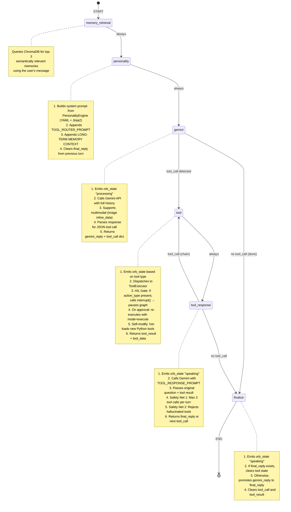
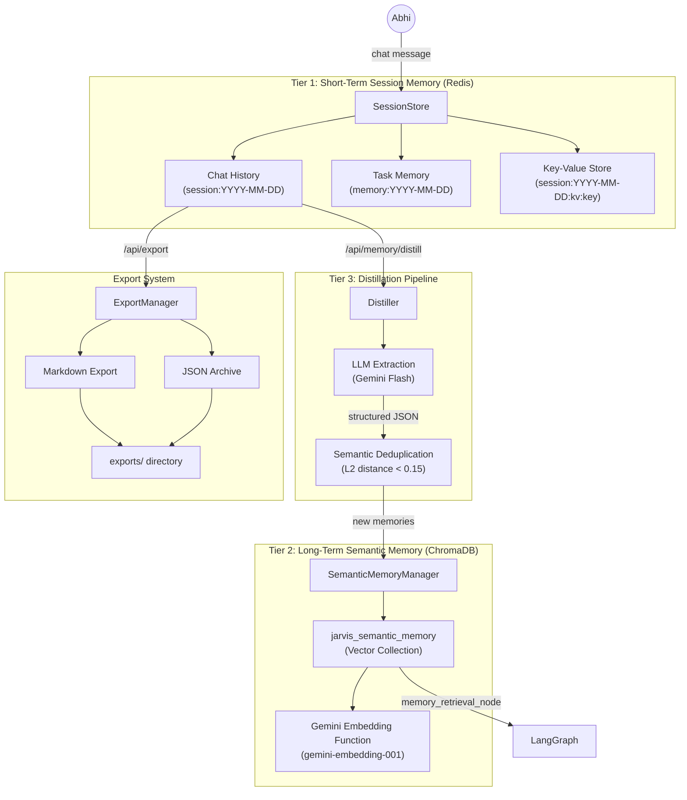
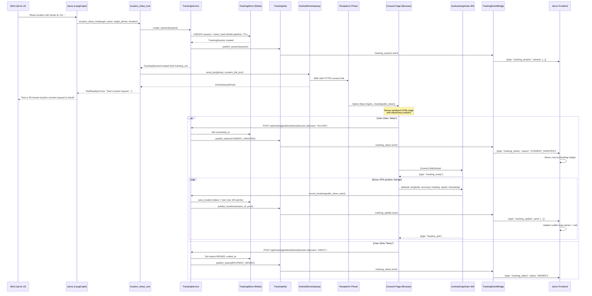
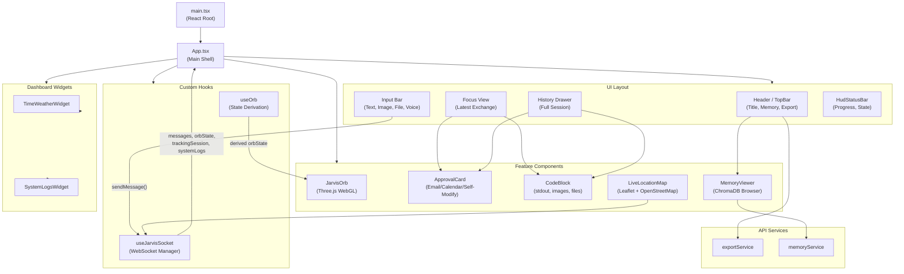

# Jarvis 2.0 — Complete Architecture Documentation

---

## 1. What is Jarvis 2.0?

Jarvis 2.0 is a **personal AI assistant** built exclusively for Abhi. It is an autonomous, multi-step reasoning agent capable of tool chaining, code execution, web research, email drafting, calendar management, financial analysis, live location tracking, and self-modification. Jarvis operates as a full-stack application with a **FastAPI + LangGraph** backend and a **React + TypeScript** frontend connected over **WebSockets** for real-time bidirectional communication.

### Core Identity

- **Name:** Jarvis 2.0
- **Role:** Personal AI assistant for Abhi
- **Mission:** Help Abhi stay productive, informed, organized, healthy, and successful
- **Personality:** Intelligent, calm, reliable, professional, friendly, with occasional light humor
- **Architecture Pattern:** ReAct (Reason + Act) loop powered by Google Gemini LLM and LangGraph state machine

### Key Capabilities

| Capability | Description |
|---|---|
| Multi-step Reasoning | Autonomous tool chaining via ReAct loop (up to 3 tools per turn) |
| Software Engineering | Code generation, execution in E2B sandboxes, debugging |
| Research & Analysis | Deep web research with structured Markdown reports |
| Financial Analysis | Full public-company financial analysis pipeline |
| Task Management | Redis-backed task memory with save/retrieve/list/clear |
| Email & Calendar | Gmail integration with Human-in-the-Loop approval |
| Multimodal Vision | Image analysis via Gemini's vision capabilities |
| Self-Modification | Write and hot-load new Python tools at runtime |
| Location Tracking | Consent-based GPS sharing with live map UI |
| Voice Interface | Vapi SDK integration for hands-free voice interaction |
| Long-Term Memory | ChromaDB semantic memory with Gemini embeddings |
| Project Generation | Full-stack project scaffolding via Engineering Team tool |

---

## 2. Tech Stack

### Backend

| Technology | Purpose |
|---|---|
| **Python 3.12+** | Core backend language |
| **FastAPI** (v0.115.6) | HTTP/WebSocket API framework |
| **Uvicorn** (v0.34.0) | ASGI server |
| **LangGraph** | State-machine based agent orchestration with checkpointing |
| **Google Gemini API** (`gemini-3.5-flash`) | Primary LLM for reasoning, tool routing, and responses |
| **Google GenAI SDK** (`google-genai`) | Embeddings (`gemini-embedding-001`) for semantic memory |
| **Redis** (async via `redis.asyncio`) | Session storage, task memory, key-value store, tracking store |
| **ChromaDB** | Persistent vector database for long-term semantic memory |
| **Pydantic** (v2.10.4) | Data validation, serialization, and settings management |
| **Pydantic Settings** (v2.7.1) | Environment variable configuration |
| **Jinja2** | Personality prompt templating |
| **PyYAML** | Personality configuration file parsing |
| **httpx** | Async HTTP client for SMS gateway communication |
| **E2B** | Cloud sandbox for safe Python code execution |

### Frontend

| Technology | Purpose |
|---|---|
| **React 19** | UI framework |
| **TypeScript** (v5.7.2) | Type-safe frontend development |
| **Vite** (v5) | Build tool and dev server |
| **Three.js** (v0.184) | 3D WebGL rendering for the Jarvis orb |
| **React Leaflet** (v5) + **Leaflet** (v1.9.4) | Interactive live-tracking map |
| **Lucide React** | Icon library |
| **React Markdown** + **React Syntax Highlighter** | Markdown rendering with code syntax highlighting |
| **Prism.js** + **Prism Themes** | Code highlighting themes |
| **Vapi Web SDK** (v2.5.2) | Voice call integration |
| **React Simple Code Editor** | In-UI code editing for self-modify approval |

### Infrastructure

| Technology | Purpose |
|---|---|
| **Docker Compose** | Container orchestration (Redis) |
| **Redis** (Docker) | Persistent session and tracking data store |
| **ngrok** | Public HTTPS tunneling for tracking consent links |

---

## 3. High-Level Architecture — End-to-End Workflow

```mermaid
flowchart TB
    subgraph Frontend ["Frontend (React + TypeScript + Vite)"]
        UI["Jarvis UI<br/>(App.tsx)"]
        Orb["3D Orb<br/>(Three.js WebGL)"]
        WS_Hook["useJarvisSocket<br/>(WebSocket Hook)"]
        Map["LiveLocationMap<br/>(Leaflet)"]
        Memory_UI["MemoryViewer<br/>(ChromaDB Browser)"]
        Widgets["Dashboard Widgets<br/>(Time/Weather, System Logs)"]
        Vapi["Vapi Voice SDK"]
    end

    subgraph Backend ["Backend (FastAPI + Python)"]
        Main["main.py<br/>(FastAPI App)"]
        WS_EP["/ws/chat<br/>(WebSocket Endpoint)"]
        REST["REST API Endpoints<br/>(/api/session, /api/memory,<br/>/api/export, /api/upload,<br/>/api/auth/google)"]

        subgraph Orchestration ["LangGraph Orchestration"]
            Graph["jarvis_graph<br/>(StateGraph)"]
            MemNode["memory_retrieval_node"]
            PersonNode["personality_node"]
            GeminiNode["gemini_node"]
            ToolNode["tool_node"]
            ToolRespNode["tool_response_node"]
            FinalNode["finalize_node"]
        end

        subgraph LLM ["LLM Layer"]
            GeminiClient["gemini_client.py<br/>(HTTP → Gemini API)"]
            GeminiAPI["Google Gemini API<br/>(gemini-3.5-flash)"]
        end

        subgraph Tools ["Tool Registry (18 Tools)"]
            ToolReg["ToolRegistry"]
            DT["datetime_tool"]
            LOC["location_tool"]
            WX["weather_tool"]
            NEWS["news_tool"]
            TMT["task_memory_tool"]
            SYS["system_info_tool"]
            WEB_S["web_search_tool"]
            RES["research_tool"]
            CODE["code_execution_tool"]
            CAL["calendar_tool"]
            EMAIL["email_tool"]
            SCRAPE["web_scraper_tool"]
            MCP_R["mcp_filesystem_read"]
            MCP_W["mcp_filesystem_write"]
            SELF["self_modify_tool"]
            ENG["engineering_team_tool"]
            FIN["financial_analyst_tool"]
            LOCSH["location_share_tool"]
        end

        subgraph MemoryLayer ["Memory Layer"]
            SessionStore["SessionStore<br/>(Redis)"]
            SemanticMem["SemanticMemoryManager<br/>(ChromaDB + Gemini Embeddings)"]
            Distiller["Distiller<br/>(LLM-powered extraction)"]
            ExportMgr["ExportManager<br/>(Markdown + JSON)"]
        end

        subgraph TrackingSystem ["Location Tracking System"]
            TrackSvc["TrackingService"]
            TrackStore["TrackingStore<br/>(Redis DB 1)"]
            TrackHub["TrackingHub<br/>(In-process pub/sub)"]
            TrackBridge["TrackingEventBridge"]
            SMSGateway["AndroidSmsGateway<br/>(httpx → Phone)"]
            ConsentPage["Consent Page<br/>(Server-rendered HTML)"]
        end
    end

    subgraph External ["External Services"]
        GeminiExt["Google Gemini API"]
        RedisExt["Redis Server"]
        ChromaExt["ChromaDB<br/>(Local Persistent)"]
        E2BExt["E2B Sandbox"]
        GmailExt["Gmail API"]
        GCalExt["Google Calendar API"]
        SerperExt["Serper API"]
        PerplexityExt["Perplexity API"]
        WeatherExt["OpenWeatherMap API"]
        NewsExt["NewsData.io API"]
        SMSPhone["Android Phone<br/>(SMS Gateway)"]
    end

    User((Abhi)) -->|"Text / Image / Voice / File"| UI
    UI <-->|"WebSocket JSON"| WS_Hook
    WS_Hook <-->|"ws://127.0.0.1:8000/ws/chat"| WS_EP

    UI --> REST

    WS_EP --> Main
    Main --> Graph

    Graph --> MemNode --> PersonNode --> GeminiNode
    GeminiNode -->|"Tool Call Detected"| ToolNode
    GeminiNode -->|"No Tool Call"| FinalNode
    ToolNode --> ToolRespNode
    ToolRespNode -->|"Chain Another Tool"| ToolNode
    ToolRespNode -->|"Done"| FinalNode
    FinalNode -->|"final_reply"| WS_EP

    GeminiNode --> GeminiClient --> GeminiAPI
    ToolRespNode --> GeminiClient

    ToolNode --> ToolReg
    ToolReg --> DT & LOC & WX & NEWS & TMT & SYS
    ToolReg --> WEB_S & RES & CODE & CAL & EMAIL & SCRAPE
    ToolReg --> MCP_R & MCP_W & SELF & ENG & FIN & LOCSH

    MemNode --> SemanticMem --> ChromaExt
    SessionStore --> RedisExt
    Distiller --> SemanticMem
    Distiller --> GeminiClient

    LOCSH --> TrackSvc --> TrackStore --> RedisExt
    TrackSvc --> TrackHub --> TrackBridge --> WS_EP
    LOCSH --> SMSGateway --> SMSPhone
    TrackSvc --> ConsentPage

    CODE --> E2BExt
    CAL --> GCalExt
    EMAIL --> GmailExt
    WEB_S --> SerperExt
    RES --> PerplexityExt
    WX --> WeatherExt
    NEWS --> NewsExt

    WS_EP -->|"orb_state"| Orb
    WS_EP -->|"tracking_update"| Map
    WS_EP -->|"message"| UI
```



---

## 4. Available Tools — Detailed Functionality

Jarvis 2.0 has **18 registered tools** loaded at startup. Each tool extends `BaseTool` (Pydantic model) and implements an `async run(**kwargs) → ToolResult` method.

### Tool Registry Architecture

```
tools/base.py          → BaseTool (abstract), ToolResult (response schema)
tools/registry.py      → ToolRegistry (singleton dict-based registry)
tools/schemas.py       → ToolCall (parsed tool invocation schema)
tools/parser.py        → try_parse_tool_call() (JSON extraction from LLM text)
tools/tool_executer.py → ToolExecutor (dispatches ToolCall → BaseTool.run())
```

### Complete Tool Reference

| # | Tool Name | Purpose | Arguments | External Dependency |
|---|---|---|---|---|
| 1 | `datetime_tool` | Current date, time, day of week | None | System clock |
| 2 | `location_tool` | Current city/location detection | None | IP geolocation API |
| 3 | `weather_tool` | Weather forecasts | `city` (optional) | OpenWeatherMap API |
| 4 | `news_tool` | Latest headlines | None | NewsData.io API |
| 5 | `task_memory_tool` | Save/retrieve tasks, reminders, notes | `action` (remember\|retrieve\|list\|clear), `task`, `query` | Redis |
| 6 | `system_info_tool` | CPU, RAM, disk, battery usage | None | `psutil` |
| 7 | `web_search_tool` | Quick web search for facts | `query` | Serper API |
| 8 | `research_tool` | Deep structured research reports | `topic`, `message` | Perplexity API |
| 9 | `code_execution_tool` | Sandboxed Python code execution | `task` (plain English), `file_ref` (optional) | E2B Sandbox |
| 10 | `calendar_tool` | List/create Google Calendar events | `mode`, `title`, `start_time`, `end_time`, `attendees` | Google Calendar API |
| 11 | `email_tool` | Search/send Gmail emails | `mode` (search\|send), `query`, `to`, `subject`, `body` | Gmail API |
| 12 | `web_scraper_tool` | Full-page web scraping (JS-heavy) | `url` | Headless browser / HTTP |
| 13 | `mcp_filesystem_read_file` | Read local files in sandbox | `path` | MCP filesystem server |
| 14 | `mcp_filesystem_write_file` | Write local files in sandbox | `path`, `content` | MCP filesystem server |
| 15 | `self_modify_tool` | Write new Python tools and hot-load them | `filename`, `code` | Local filesystem |
| 16 | `location_share_tool` | Consent-based GPS location sharing | `target_name`, `target_phone`, `duration_minutes` | SMS Gateway + Tracking Service |
| 17 | `engineering_team_tool` | Full project generation & testing | `requirements`, `target_stack_hint` (optional) | E2B Sandbox |
| 18 | `financial_analyst_tool` | Public-company financial analysis pipeline | `ticker`, `company_name`, `analysis_type`, `analysis_depth`, `investment_horizon`, `compare_with`, `report_language` | Yahoo Finance, Web scraping, Gemini |

### Tool Routing Rules

The LLM uses the `TOOL_ROUTER_PROMPT` (609 lines in `prompts.py`) to decide which tool to call. Key routing decisions:

- **`research_tool` vs `web_search_tool`**: Research tool for structured reports ("research", "deep dive", "analyze"); Web search for quick facts ("latest", "recent", "update").
- **`web_scraper_tool` chaining**: After a `web_search_tool` call, if the user asks "what does X do", Jarvis MUST chain to `web_scraper_tool` to read the full page.
- **`task_memory_tool` auto-capture**: Always called when the user states patterns like "I have a meeting at 10am", "Remind me to...", "Note that...".
- **`financial_analyst_tool` routing**: Only for publicly traded companies. Depth maps: "deep analysis" → `deep`, "quick overview" → `quick`, default → `standard`.

### Human-in-the-Loop (HIL) Approval Gate

Tools that produce sensitive side effects (sending emails, creating calendar events, self-modification) use a **LangGraph interrupt** mechanism:

1. Tool returns `ToolResult` with `data.action_type` set (e.g., `"send_email"`, `"calendar_event"`, `"self_modify"`)
2. `tool_node` calls `interrupt(approval_payload)` → pauses the graph
3. Frontend receives an `approval_request` message and renders an `ApprovalCard`
4. User clicks Approve/Reject → frontend sends `approval_response` via WebSocket
5. `main.py` resumes the graph with `Command(resume=resume_payload)`
6. If approved, the tool re-executes with `mode: "execute"`; if rejected, the action is cancelled

---

## 5. Orchestration Layer — The LangGraph State Machine

### Graph State Schema

Defined in `backend/agents/graph_state.py` as `JarvisState(TypedDict)`:

```python
class JarvisState(TypedDict, total=False):
    # ── Inputs ──
    user_message: str                    # Raw user text
    history: list[dict[str, str]]        # Full conversation history
    memory_facts: list[str]              # Task memory facts
    image_data: str | None               # Base64 image from UI

    # ── Set by personality_node ──
    system_prompt: str                   # Combined personality + tool router prompt

    # ── Set by memory_retrieval_node ──
    memory_context: str                  # ChromaDB semantic memory context

    # ── Set by gemini_node ──
    gemini_reply: str                    # Raw LLM response text
    tool_call: dict[str, Any] | None     # Parsed tool call JSON (or None)

    # ── Set by tool_node / tool_response_node ──
    tool_result: Any                     # Tool execution result
    tool_data: dict | None               # Additional tool data (e.g., code_result)
    tool_calls_made: int                 # ReAct loop counter (safety limit: 3)

    # ── Output ──
    final_reply: str                     # Final text sent to the user
```

### Low-Level Graph Diagram



### Node-by-Node Breakdown

#### 1. `memory_retrieval_node`
- **File:** `graph_nodes.py:51-77`
- **Purpose:** Queries ChromaDB for long-term memories relevant to the user's message
- **Process:** Runs `semantic_memory.query_memories(query_text=user_message, n_results=3)` in a thread executor (ChromaDB is synchronous)
- **Output:** Sets `memory_context` as formatted bullet points with type and source date

#### 2. `personality_node`
- **File:** `graph_nodes.py:82-95`
- **Purpose:** Constructs the full system prompt for Gemini
- **Process:**
  1. Calls `PersonalityEngine.build_system_prompt()` — loads personality from `personality.yaml` and renders via Jinja2 templates (`default.j2`, `playful.j2`, `stressed.j2`, `code_heavy.j2`)
  2. Appends `TOOL_ROUTER_PROMPT` (all 18 tool definitions + routing rules)
  3. Appends `LONG-TERM MEMORY CONTEXT` if any memories were retrieved
  4. **Critical fix:** Clears `final_reply` to prevent the graph from skipping tools
- **Output:** Sets `system_prompt` and clears `final_reply`

#### 3. `gemini_node`
- **File:** `graph_nodes.py:98-159`
- **Purpose:** Calls Google Gemini API and parses the response
- **Process:**
  1. Emits `orb_state: processing` to the UI
  2. Handles multimodal input: if `image_data` is present, constructs `inline_data` parts
  3. Calls `generate_reply_with_history()` with full session history
  4. Uses `try_parse_tool_call()` to extract JSON tool calls from the response text
  5. Converts ToolCall to dict for LangGraph serialization
- **Output:** Sets `gemini_reply` (raw text) and `tool_call` (dict or None)

#### 4. `route_after_gemini`
- **File:** `graph_nodes.py:162-165`
- **Purpose:** Conditional edge — routes to `tool` node if a tool call was detected, otherwise to `finalize`
- **Logic:** Returns `"done"` if `final_reply` already set (error case) or no `tool_call`; returns `"tool"` otherwise

#### 5. `tool_node`
- **File:** `graph_nodes.py:168-259`
- **Purpose:** Executes the requested tool and handles HIL approval flow
- **Process:**
  1. Emits appropriate orb state (`processing_code` for code, `processing` for others)
  2. Fixes Gemini's occasional argument name mismatches (e.g., `code` → `task` for `code_execution_tool`)
  3. Dispatches to `ToolExecutor.execute()`
  4. **HIL Gate:** If the tool returns `action_type`, calls `interrupt()` to pause the graph
  5. On approval: re-executes with `mode: "execute"` and the original draft
  6. **Self-modify flow:** On approval, dynamically loads the new `.py` file via `importlib`, finds `BaseTool` subclasses, and registers them in the `ToolRegistry`
  7. On rejection: sets `content = "User rejected the action."` with `success = False`
- **Output:** Sets `tool_result` and `tool_data`

#### 6. `tool_response_node`
- **File:** `graph_nodes.py:262-315`
- **Purpose:** Sends the tool result back to Gemini for interpretation, enabling tool chaining
- **Process:**
  1. Emits `orb_state: speaking`
  2. Calls Gemini with `TOOL_RESPONSE_PROMPT`, passing the original question and tool output
  3. Parses the response for another potential tool call (ReAct loop)
  4. **Safety Net 1:** If `tool_calls_made >= 3`, forces a final reply (prevents infinite loops)
  5. **Safety Net 2:** Validates the next tool call against `ToolRegistry`; rejects hallucinated tool names
- **Output:** Sets `final_reply` OR next `tool_call` + increments `tool_calls_made`

#### 7. `route_after_tool_response`
- **File:** `graph.py:39-50`
- **Purpose:** Conditional edge — continues the ReAct loop if another tool call is needed, otherwise finalizes
- **Logic:** Returns `"tool"` if `tool_call` is set; `"finalize"` otherwise

#### 8. `finalize_node`
- **File:** `graph_nodes.py:318-323`
- **Purpose:** Prepares the final output and cleans up graph state
- **Process:**
  1. Emits `orb_state: speaking`
  2. If `final_reply` already exists (from tool_response), clears `tool_call` and `tool_result`
  3. If not, promotes `gemini_reply` to `final_reply` (direct response, no tools used)
- **Output:** Sets `final_reply`, clears `tool_call` and `tool_result`

### Graph Compilation

```python
# graph.py:122-129
checkpointer = MemorySaver()   # In-memory checkpointer for interrupt/resume
jarvis_graph = graph.compile(checkpointer=checkpointer)
```

The `MemorySaver` checkpointer enables the **interrupt/resume** pattern used by the HIL approval gate. When `interrupt()` is called in `tool_node`, the graph state is saved. When the user approves/rejects, `main.py` resumes with `Command(resume=payload)` and the same `thread_id`.

---

## 6. Infrastructure & Memory Management

Jarvis 2.0 has a **three-tier memory architecture**:



### Tier 1: Session Storage (Redis)

**File:** `backend/memory/session_storage.py`

The `SessionStore` class manages all ephemeral, day-scoped data in Redis:

| Storage Type | Redis Key Pattern | TTL | Purpose |
|---|---|---|---|
| Chat History | `session:YYYY-MM-DD` | 24 hours | Full conversation transcript (user, assistant, tool messages) |
| Task Memory | `memory:YYYY-MM-DD` | 24 hours | User's tasks, reminders, notes |
| Key-Value | `session:YYYY-MM-DD:kv:{key}` | 24 hours | Arbitrary session-scoped data (research context, agent state) |

**Fallback:** If Redis is unavailable, `SessionStore` transparently falls back to **in-memory dictionaries** — the same API, no code changes needed.

**Operations:**
- `append_message(role, content, **kwargs)` — Appends a message to today's session list (`RPUSH`)
- `load_session(date_str?)` — Loads all messages for a date (`LRANGE 0 -1`)
- `clear_session(date_str?)` — Deletes a session key
- `save_memory(text)` / `load_memories()` / `clear_memories()` — Task memory CRUD
- `get_value(key)` / `set_value(key, value)` / `delete_value(key)` — KV store

### Tier 2: Semantic Memory (ChromaDB)

**File:** `backend/memory/semantic.py`

The `SemanticMemoryManager` manages Jarvis's long-term memory using ChromaDB with Gemini embeddings:

**Embedding Function:** Custom `CustomGeminiEmbeddingFunction` wraps the `google-genai` SDK to call `models/gemini-embedding-001`. This bypasses ChromaDB's broken legacy Google wrapper.

**Database Location:** `backend/data/chroma/` (local persistent storage)

**Collection:** `jarvis_semantic_memory` with Gemini embeddings

**Schema (MemoryEntry):**

| Field | Type | Description |
|---|---|---|
| `id` | UUID | Unique memory identifier |
| `type` | Enum | `preference`, `personal_fact`, `decision`, `task_outcome`, `project_context`, `relationship`, `boundary`, `recurring_topic` |
| `content` | str | The memory text (e.g., "Abhi prefers Python for backend development") |
| `source_date` | date | When the memory was created |
| `source_ref` | str | Reference (e.g., `"session:2026-06-23"`) |
| `confidence` | float | 0.0–1.0 confidence score |
| `pinned` | bool | If true, memory is protected from deletion |
| `sensitivity` | Enum | `low`, `personal`, `private`, `secret` |
| `last_used` | datetime | Last time the memory was retrieved in a query |
| `expires_at` | datetime | Optional expiration |
| `embedding_model` | str | Model used for embedding (default: `models/text-embedding-004`) |

**Operations:**
- `add_memory(memory)` — Upserts a MemoryEntry into ChromaDB
- `query_memories(query_text, n_results=5)` — Semantic similarity search
- `get_all_memories()` — Retrieves all memories (for the Memory Viewer UI)
- `update_memory(memory)` — Updates content or metadata
- `delete_memory(memory_id)` — Deletes a specific memory
- `wipe_all_memories()` — Destructive full wipe

### Tier 3: Distillation Pipeline

**File:** `backend/memory/distiller.py`

The `Distiller` extracts long-term memories from conversation transcripts using Gemini:

**Pipeline:**
1. **Load transcript** from Redis (`session_store.load_session()`)
2. **Format** messages into a readable text transcript
3. **Extract** structured JSON memories via Gemini Flash with `_DISTILLATION_PROMPT`:
   - Extracts: preferences, decisions, personal facts, project context, task outcomes
   - Ignores: small talk, greetings, transient questions, raw tool outputs
   - Returns: `[{type, content, confidence, sensitivity}]`
4. **Deduplicate** against existing ChromaDB memories:
   - Queries ChromaDB with the new memory content
   - If L2 distance < 0.15, considers it a duplicate and skips
5. **Save** new, non-duplicate memories to ChromaDB

**Trigger:** Called via `POST /api/memory/distill` endpoint

### Export System

**File:** `backend/memory/export_manager.py`

- Exports today's session as **Markdown** (user-facing download) + **JSON** (structured archive)
- Archives JSON to `backend/exports/` directory
- Wipes the Redis session after export (fresh start)
- Triggered via `POST /api/export` — returns Markdown as `PlainTextResponse` with download headers

---

## 7. Location Share Tool — Detailed Architecture

The location sharing system is a **consent-based, time-limited GPS tracking** feature that spans multiple backend modules and a server-rendered consent page.

### System Overview



### Components Breakdown

#### 1. `location_share_tool.py` (Tool Layer)

**File:** `backend/tools/location_share_tool.py`

This is the entry point invoked by the LangGraph `tool_node`. It orchestrates the full flow:

1. **Validate input** — Creates a `CreateTrackingSessionRequest` (Pydantic model with phone validation: 8-15 digits, cleaned to `+{digits}` format)
2. **Create tracking session** — Calls `tracking_service.create_session(request)` which:
   - Generates a UUID session ID
   - Creates a cryptographically secure `public_token` (32 bytes, URL-safe)
   - Stores session + hashed token in Redis with TTL = `duration_minutes * 60`
   - Publishes session creation event via `TrackingHub`
   - Returns `TrackingSessionCreated` with the public tracking URL
3. **Validate tracking URL** — Ensures HTTPS and non-localhost (must be ngrok public URL)
4. **Send SMS** — Uses `AndroidSmsGateway.from_env()` to send consent link via the user's Android phone
5. **Return result** — Returns `ToolResult` with session details, SMS delivery status, and message ID

**Error handling:**
- `ValidationError` → Invalid recipient details
- `SmsGatewayError` / `ValueError` → SMS failed, session is cleaned up
- Any other exception → Generic failure, session is cleaned up

#### 2. Tracking Service (`backend/tracking/service.py`)

The core business logic for tracking sessions:

| Method | Purpose |
|---|---|
| `create_session()` | Creates session, generates token, stores in Redis, publishes event |
| `get_status()` | Returns session status by session_id |
| `resolve_public_token()` | Looks up session by hashing the public token |
| `get_public_view()` | Returns public-safe session view (no phone number) |
| `allow_session()` | Sets `consented_at`, publishes CONSENT_GRANTED |
| `deny_session()` | Sets status=DENIED, ended_at, publishes RECIPIENT_DENIED |
| `stop_by_public_token()` | Recipient stops sharing (RECIPIENT_STOPPED) |
| `stop_session()` | Requester (Abhi) stops tracking (REQUESTER_STOPPED) |
| `record_location()` | Records GPS point, checks expiry, publishes location update |

**Security:**
- Public tokens are 32-byte cryptographic secrets, URL-safe encoded
- Tokens are SHA-256 hashed before storage (server never stores plaintext tokens)
- Phone numbers are masked in public-facing responses (`+91 •••••• 3210`)
- Sessions have strict TTL enforcement in Redis

#### 3. Tracking Store (`backend/tracking/store.py`)

Redis-backed persistence using four key namespaces:

| Prefix | Purpose |
|---|---|
| `tracking:session:{id}` | Session JSON (TTL = duration) |
| `tracking:token:{hash}` | Token → session_id mapping (TTL = duration) |
| `tracking:latest:{id}` | Latest GPS point JSON (TTL = session TTL) |
| `tracking:trail:{id}` | List of GPS points, max 100, LIFO trimmed (TTL = session TTL) |

All writes use **Redis pipelines** with transactions for atomicity.

#### 4. Tracking Hub (`backend/tracking/tracking_hub.py`)

An in-process **pub/sub broadcaster** using `asyncio.Queue`:

- Subscribers (the `TrackingEventBridge`) register queues
- All tracking events are broadcast to all subscribers
- Back-pressure handling: if a queue is full, old events are dropped (slow UI never blocks GPS ingestion)
- Event types: `tracking_session`, `tracking_status`, `tracking_update`

#### 5. Tracking Event Bridge (`backend/tracking/bridge.py`)

Bridges tracking events from `TrackingHub` to the Jarvis frontend WebSocket:

- Subscribes to `TrackingHub` on WebSocket connection
- Runs a background `asyncio.Task` that forwards events via `websocket.send_json()`
- Cleaned up when the WebSocket disconnects

#### 6. SMS Gateway (`backend/tracking/sms_gateway.py`)

Sends SMS messages via the **SMS Gateway for Android** app running in Local Server mode:

- Configured via environment variables: `SMS_GATEWAY_URL`, `SMS_GATEWAY_USERNAME`, `SMS_GATEWAY_PASSWORD`
- Uses `httpx.AsyncClient` with Basic Auth
- Supports SIM selection (dual-SIM phones)
- Returns `SmsGatewayResult` with message ID and delivery state

#### 7. Consent Page (`backend/tracking/consent_page.py`)

A **server-rendered HTML page** served at `/track/{public_token}`:

- Dark-themed, mobile-responsive design with glassmorphism aesthetics
- Shows requester name, duration, countdown timer
- Two buttons: **Allow** (green) and **Deny** (red)
- On Allow:
  1. Requests browser `navigator.geolocation.watchPosition()` with high accuracy
  2. Opens a WebSocket to `/ws/tracking/share/{public_token}`
  3. Streams GPS positions to the backend with smart throttling:
     - Always send if >15 seconds since last send
     - Skip if <3 seconds since last send
     - Between 3-15s: send only if moved ≥5 meters (Haversine distance)
  4. Shows real-time GPS accuracy and last-sent timestamp
  5. **Stop** button to end sharing immediately
- Handles visibility changes (warns user when page is hidden)
- Handles all terminal states (DENIED, ENDED, EXPIRED)

#### 8. Tracking Routes (`backend/tracking/routes.py`)

| Route | Method | Auth | Purpose |
|---|---|---|---|
| `/api/tracking/sessions` | POST | Admin token | Create tracking session |
| `/api/tracking/sessions/{id}` | GET | Admin token | Get session status |
| `/api/tracking/sessions/{id}/stop` | POST | Admin token | Stop session (requester) |
| `/track/{public_token}` | GET | None (public) | Consent page HTML |
| `/api/tracking/public/{token}/decision` | POST | None (public) | Submit ALLOW/DENY |
| `/api/tracking/public/{token}/stop` | POST | None (public) | Recipient stops sharing |
| `/ws/tracking/share/{public_token}` | WS | None (public) | GPS data streaming |

**Security headers** on the consent page: `no-store`, `no-cache`, `no-referrer`, `geolocation=(self)`, strict CSP, `frame-ancestors 'none'`.

---

## 8. Frontend Architecture

The frontend is a **React 19 + TypeScript** single-page application built with Vite, featuring a futuristic dark-themed HUD-style interface.

### File Structure

```
frontend/src/
├── main.tsx                          # React root mount
├── App.tsx                           # Main application shell
├── types.ts                          # TypeScript type definitions
├── styles.css                        # Global CSS (39KB, full design system)
│
├── hooks/
│   ├── useJarvisSocket.ts            # WebSocket connection, message handling, tracking state
│   └── useOrb.ts                     # Orb state derivation
│
├── components/
│   ├── Orb/
│   │   ├── JarvisOrb.tsx             # Three.js WebGL 3D orb (27KB)
│   │   └── OrbStates.ts             # Orb state configurations (8 states, 12 params each)
│   ├── ApprovalCard.tsx              # HIL approval/reject UI
│   ├── CodeBlock.tsx                 # Code execution result display
│   ├── HudStatusBar.tsx              # Bottom status bar
│   ├── MemoryViewer.tsx              # ChromaDB memory browser
│   ├── tracking/
│   │   └── LiveLocationMap.tsx       # Leaflet-based live GPS map
│   └── widgets/
│       ├── TimeWeatherWidget.tsx     # Time + weather dashboard widget
│       └── SystemLogsWidget.tsx      # Real-time system log viewer
│
└── services/
    ├── exportService.ts              # Conversation export API client
    └── memoryService.ts              # ChromaDB memory CRUD API client
```

### Component Architecture



### Key Components Detail

#### `App.tsx` — Main Application Shell

The root component manages the overall layout and state:

- **Focus View:** Shows only the latest user message and Jarvis response (HUD-style)
- **History Drawer:** Sliding panel with full session history (opened via hamburger menu)
- **Input Bar:** Multi-input form supporting:
  - Text messages
  - Image paste/drag-drop/file select (converted to base64 `data:` URLs)
  - Data file upload (CSV, JSON, TXT, XLSX) via `/api/upload`
  - Voice input toggle (Vapi SDK)
- **Vapi Voice Integration:** Initializes Vapi SDK, handles call start/end, speech events, and voice transcripts
- **Message Rendering:** Uses `ReactMarkdown` with `react-syntax-highlighter` (OneDark theme) for rich markdown output

#### `useJarvisSocket` — WebSocket Manager

The heart of the frontend, managing all real-time communication:

**Connection Management:**
- Connects to `ws://127.0.0.1:8000/ws/chat`
- Auto-reconnects on disconnection (2-second delay)
- Graceful cleanup on component unmount

**Session Restoration:**
- On mount, fetches `GET /api/session` to restore today's chat history
- Converts Redis messages to `ChatMessage` objects (with code results and images)

**Message Types Handled:**

| WebSocket Message Type | Frontend Action |
|---|---|
| `heartbeat` | Ignored (keepalive) |
| `orb_state` | Updates 3D orb animation state |
| `status` | Updates orb state from processing lifecycle |
| `research_progress` | Shows research workflow progress text |
| `message` | Appends assistant message to chat |
| `stream_chunk` | Accumulates streaming response chunks |
| `approval_request` | Renders ApprovalCard for HIL actions |
| `hil_card` | Engineering Team HIL card (deprecated in v2) |
| `tracking_session` | Creates tracking session state for map widget |
| `tracking_status` | Updates tracking status (consent, denied, expired, etc.) |
| `tracking_update` | Updates live GPS position on map |
| `error` | Shows error in UI |

**Exposed API:**
- `sendMessage(text, image?)` — Sends user message via WebSocket
- `sendApproval(approved, editedCode?)` — Sends HIL approval/rejection
- `clearMessages(initial?)` — Resets messages (after export)
- `stopTracking(sessionId)` — Sends tracking stop command
- `dismissTracking()` — Hides tracking widget (only for terminal sessions)

#### `JarvisOrb.tsx` — Three.js 3D Orb

A 27KB WebGL-rendered animated orb using Three.js:

- **8 visual states:** sleeping, idle, waking, listening, processing, processing_code, speaking, error
- **Each state has 12 parameters:** primary/secondary/core colors, speed, intensity, pulse, particle opacity, ring opacity, distortion, jitter
- Smooth transitions between states with lerp/damping
- Particle system and orbital rings for ambient animation
- Color palettes shift based on what Jarvis is doing:
  - Cyan/teal = idle/ready
  - Orange/cyan = processing
  - Orange/yellow = executing code
  - Red = error
  - Green/cyan = listening (voice)
  - White/cyan = speaking/responding

#### `LiveLocationMap.tsx` — Real-Time GPS Map

A Leaflet-based interactive map component:

- **Map tiles:** OpenStreetMap
- **Features:**
  - Auto-centers on latest GPS position with `flyTo()` animation
  - Accuracy circle overlay (transparent radius based on GPS accuracy)
  - Trail polyline showing movement history
  - Circle marker for current position
- **Status system:** PENDING → ACTIVE → STALE (>20s without update) → ENDED/EXPIRED
- **Metrics grid:** Remaining time (countdown), GPS accuracy, last update time, heading
- **Controls:** Stop tracking button, dismiss button (terminal states only)
- **Radar animation:** Shown while awaiting first GPS fix after consent

#### `MemoryViewer.tsx` — ChromaDB Browser

A modal/drawer UI for browsing and managing Jarvis's long-term memories:

- Fetches all memories via `GET /api/memory`
- Displays type, content, confidence, sensitivity, dates
- Supports delete (`DELETE /api/memory/{id}`) and edit (`PATCH /api/memory/{id}`)
- Trigger distillation button (`POST /api/memory/distill`)

#### `ApprovalCard.tsx` — Human-in-the-Loop UI

Renders approval cards for sensitive actions:

- **Email drafts:** Shows recipient, subject, body with approve/reject buttons
- **Calendar events:** Shows event details with approve/reject buttons
- **Self-modify:** Shows filename and code with an in-browser code editor (`react-simple-code-editor`). User can edit the code before approving.

#### `CodeBlock.tsx` — Code Execution Results

Renders the output of `code_execution_tool`:

- Syntax-highlighted Python code
- stdout/stderr output
- Generated images (base64 rendered inline)
- Generated files (download links via `/api/files/{filename}`)
- Execution time and success/failure status
- Retry indicator

#### Dashboard Widgets

- **`TimeWeatherWidget`:** Shows current time, date, and weather fetched from the backend
- **`SystemLogsWidget`:** Real-time log viewer showing socket events, tracking updates, memory operations, and errors with color-coded severity levels

---

## 9. Backend Entry Point — `main.py`

### Application Lifecycle

```python
@asynccontextmanager
async def lifespan(app: FastAPI):
    # STARTUP
    await session_store.connect()          # Connect Redis for sessions
    await tracking_store.connect()         # Connect Redis DB 1 for tracking

    # Register all 16 built-in tools + location_share_tool
    registry.register(DateTimeTool())
    registry.register(LocationTool())
    # ... (15 more tools)
    registry.register(LocationShareTool())

    # Initialize MCP filesystem tools
    mcp_manager = MCPManager()
    mcp_tools = await mcp_manager.initialize()
    for tool in mcp_tools:
        registry.register(tool)

    yield  # App runs here

    # SHUTDOWN
    await mcp_manager.close()
    await session_store.disconnect()
    await tracking_store.disconnect()
```

### WebSocket Endpoint (`/ws/chat`)

The main communication channel between frontend and backend:

1. **Connection:** Accepts WebSocket, starts `TrackingEventBridge`, sends `status: idle`
2. **Heartbeat:** Background task sends `{type: "heartbeat"}` every 8 seconds to prevent timeout
3. **Orb/Progress Emitters:** Context variables (`orb_emitter`, `progress_emitter`) allow graph nodes to push real-time UI updates through the WebSocket
4. **Message Loop:**
   - `tracking_stop` → Stops a tracking session via `TrackingService`
   - `approval_response` / `hil_response` → Resumes paused LangGraph with `Command(resume=payload)`
   - Normal chat → Processes through the LangGraph pipeline
5. **Graph Invocation:** `_invoke_with_ui_context()` wraps `jarvis_graph.ainvoke()` with heartbeat, orb emitter, and progress emitter
6. **Interrupt Handling:** `_send_interrupt_to_ui()` detects graph interrupts and sends either `approval_request` or `hil_card` to the frontend
7. **Result Delivery:** `_send_completed_graph_result()` sends the final reply, stores it in Redis, and includes any `code_result` data

### REST API Endpoints

| Endpoint | Method | Purpose |
|---|---|---|
| `/api/health` | GET | Health check with timestamp |
| `/api/session` | GET | Restore today's session messages |
| `/api/export` | POST | Export conversation as Markdown, archive JSON, wipe session |
| `/api/files/{filename}` | GET | Download generated files (charts, HTML) |
| `/api/upload` | POST | Upload data files (CSV, JSON, etc.) |
| `/api/memory` | GET | List all ChromaDB memories |
| `/api/memory/distill` | POST | Trigger memory distillation pipeline |
| `/api/memory/{id}` | DELETE | Delete a specific memory |
| `/api/memory/{id}` | PATCH | Update memory content/metadata |
| `/api/auth/google` | GET | Initiate Google OAuth flow |
| `/api/auth/google/callback` | GET | Handle OAuth callback |

---

## 10. Data Flow Summary

### User Message → Jarvis Response (No Tool)

```
User types message
  → Frontend: useJarvisSocket.sendMessage()
  → WebSocket: {message, image?}
  → main.py: append to Redis, build history
  → LangGraph: memory_retrieval → personality → gemini → finalize
  → WebSocket: {type: "message", content: "..."}
  → Frontend: renders Markdown in Focus View
```

### User Message → Tool Chaining

```
User: "What's the weather in Bangalore and create a reminder for gym at 6pm"
  → gemini_node: detects weather_tool call
  → tool_node: executes weather_tool
  → tool_response_node: Gemini sees weather result, decides to call task_memory_tool
  → tool_node: executes task_memory_tool (call #2)
  → tool_response_node: both results gathered, generates final reply
  → finalize_node: delivers combined answer
```

### HIL Approval Flow

```
User: "Send an email to Sourav about the meeting"
  → gemini_node: detects email_tool call
  → tool_node: email_tool returns draft with action_type="send_email"
  → tool_node: interrupt() pauses graph, saves checkpoint
  → WebSocket: {type: "approval_request", draft: {...}}
  → Frontend: renders ApprovalCard
  → User clicks "Approve"
  → WebSocket: {type: "approval_response", approved: true}
  → main.py: Command(resume=payload) with same thread_id
  → tool_node: re-executes email_tool with mode="execute"
  → tool_response_node → finalize_node → "Email sent successfully"
```

---

*This document was auto-generated by analyzing the complete Jarvis 2.0 codebase. Last updated: August 3, 2026.*
