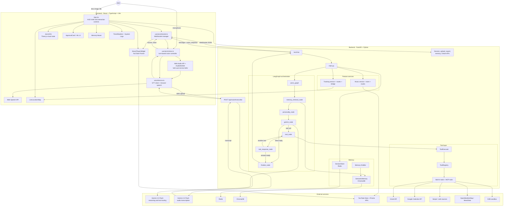
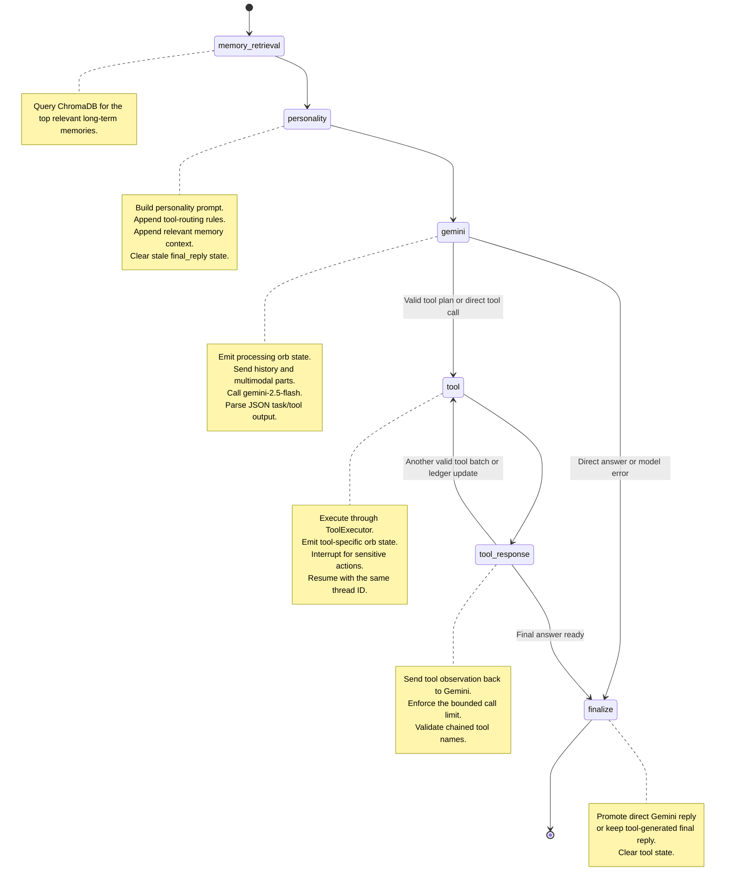
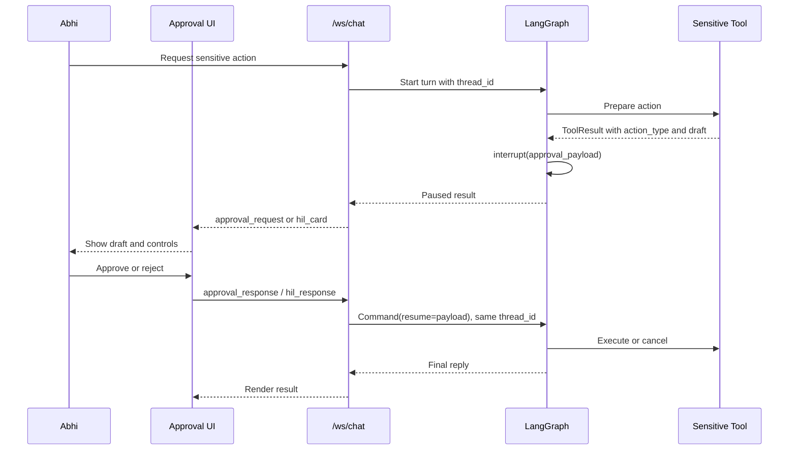
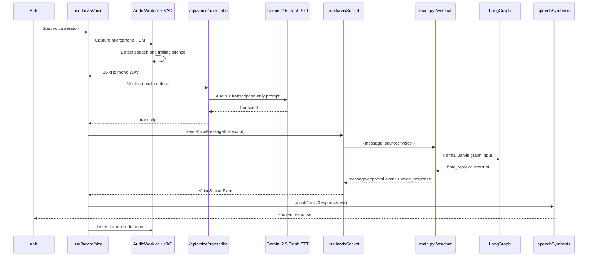
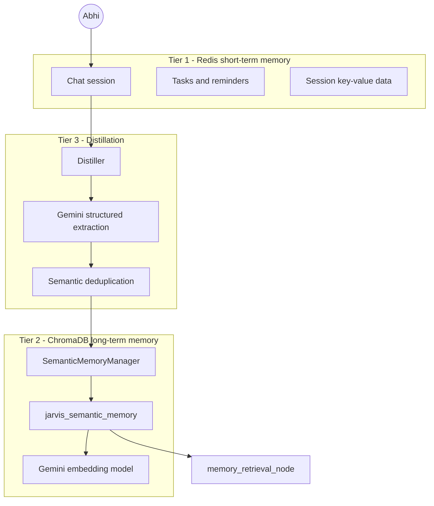
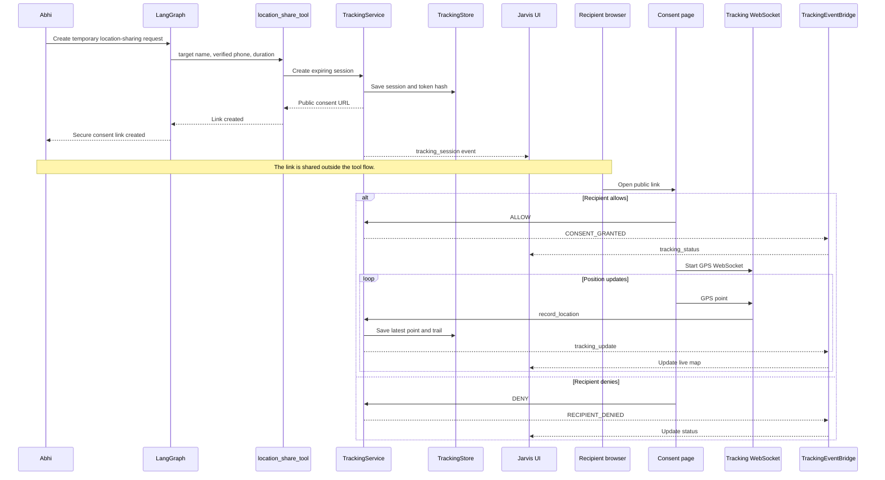
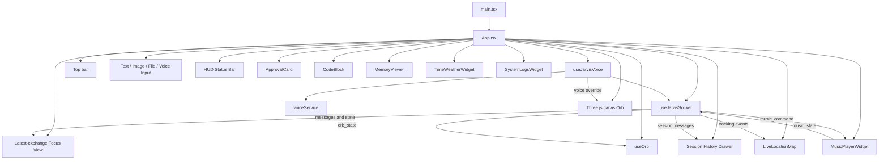

# Jarvis 2.0 - Current Architecture Documentation

> **Status:** Current architecture through the browser-voice and specialist-agent stack
> **Last updated:** August 17, 2026
> **Primary runtime:** FastAPI + LangGraph backend, React + TypeScript frontend
> **Primary reasoning model:** `gemini-2.5-flash`

---

## 1. What is Jarvis 2.0?

Jarvis 2.0 is a personal AI assistant built exclusively for Abhi. It is a full-stack, tool-using agent that can reason across multiple steps, retrieve memory, invoke external services, execute code, manage sensitive actions through Human-in-the-Loop approval, control music playback, process images and files, and support turn-based voice conversations.

Jarvis follows one central principle:

> **One orchestration brain, multiple interaction interfaces.**

Text, images, files, and voice all enter the same LangGraph orchestration layer. Voice is not a second assistant and does not own separate tools, prompts, memory, or approval logic.

### Core identity

- **Name:** Jarvis 2.0
- **Role:** Personal AI assistant for Abhi
- **Mission:** Help Abhi stay productive, informed, organized, healthy, and successful
- **Personality:** Intelligent, calm, reliable, professional, friendly, and occasionally witty
- **Reasoning pattern:** ReAct-style reason -> act -> observe -> continue/answer loop
- **Orchestration:** LangGraph state machine with checkpointing and interrupts
- **Primary LLM:** Google Gemini 2.5 Flash
- **Communication:** WebSocket-first, with focused REST endpoints for uploads, STT, memory, music, tracking, and OAuth

### Current capabilities

| Capability | Description |
|---|---|
| Multi-step reasoning | Task planning, tool chaining, and bounded autonomy |
| Software engineering | Sandboxed code execution, project generation, testing, and controlled self-modification |
| Research and analysis | Claim-driven deep research, full-page scraping, and computational verification |
| Task management | Redis-backed notes, tasks, reminders, and session-scoped state |
| Email and calendar | Gmail and Google Calendar integration protected by HIL approval |
| Multimodal input | Text, pasted images, image uploads, and data-file uploads |
| Long-term memory | ChromaDB semantic memory using Gemini embeddings |
| Location sharing | Consent-based, expiring tracking links plus live map updates after recipient consent |
| Music player | YouTube-backed playback widget with search, queue, favorites, and voice/text commands |
| Voice interface | Turn-based Gemini STT plus browser-native speech output |
| Voice-controlled HIL | Spoken approve, reject, or cancel commands resume the same paused LangGraph thread |

---

## 2. Architectural Principles

### 2.1 One authoritative orchestration path

All meaningful requests are processed by:

```text
memory retrieval
-> personality and tool-routing prompt construction
-> Gemini 2.5 Flash
-> optional tool execution
-> optional HIL interrupt
-> optional tool chaining
-> final reply
```

Voice transcripts are treated exactly like typed messages after transcription.

### 2.2 Voice is an interface, not a second agent

The voice layer performs only four responsibilities:

1. Capture one spoken utterance.
2. Transcribe it into text.
3. Send that text into the existing WebSocket/LangGraph workflow.
4. Speak the final text returned by Jarvis.

The voice layer does not independently choose tools, maintain memory, or generate assistant answers.

### 2.3 Side effects require approval

Sensitive actions such as sending email, creating calendar events, self-modification, and some project-generation paths pause the LangGraph through `interrupt()`.

The user can approve or reject through the UI. During an active voice turn, explicit spoken approval commands can resume the same saved checkpoint.

### 2.4 Text remains the source of truth

The complete answer is always available in the UI. Speech is a presentation layer over that final text.

This avoids:

- duplicated answers,
- separate voice-only memory,
- drift between text and audio,
- hidden tool execution,
- provider-specific conversational state.

### 2.5 Cost is spent on intelligence, not narration

The paid cloud components are used for reasoning and speech understanding:

- Gemini 2.5 Flash for orchestration
- Gemini 2.5 Flash for short-turn STT

Assistant speech is produced by the browser through `speechSynthesis`, so Jarvis does not call a paid TTS API.

---

## 3. Current Technology Stack

### Backend

| Technology | Purpose |
|---|---|
| Python 3.12+ | Backend language |
| FastAPI | REST and WebSocket API framework |
| Uvicorn | ASGI development/runtime server |
| LangGraph | Stateful orchestration, routing, checkpointing, and HIL interrupts |
| Gemini 2.5 Flash | Main reasoning, tool routing, response generation, and STT |
| Google GenAI / Gemini APIs | Model access and semantic-memory embeddings |
| Redis via `redis.asyncio` | Sessions, task memory, music state, tracking state, and key-value data |
| ChromaDB | Persistent long-term semantic memory |
| Pydantic | Tool, API, state, and configuration validation |
| Pydantic Settings | Environment-variable configuration |
| Jinja2 + PyYAML | Personality prompt templates and personality configuration |
| E2B | Isolated Python execution and project testing |
| httpx / HTTP clients | External API access |
| YouTube Data API v3 | Music search and metadata |
| Google OAuth APIs | Gmail and Calendar authentication |

### Frontend

| Technology | Purpose |
|---|---|
| React 19 | Application UI |
| TypeScript | Type-safe frontend |
| Vite | Build tool and development server |
| Three.js | Animated 3D Jarvis orb |
| WebSocket API | Real-time chat, tools, HIL, tracking, music, and voice-response events |
| Web Audio API | Microphone access and audio processing |
| AudioWorklet | Low-latency PCM capture for one spoken utterance |
| Web Speech API | Browser-native text-to-speech |
| React Leaflet + Leaflet | Live location map |
| YouTube IFrame Player API | Visible music playback |
| React Markdown | Rich Markdown rendering |
| React Syntax Highlighter | Code-block rendering |
| Lucide React | UI icons |
| React Simple Code Editor | Editable self-modification approval content |

### Infrastructure and local services

| Technology | Purpose |
|---|---|
| Docker Compose | Local service orchestration |
| Redis | Persistent runtime stores |
| Local ChromaDB directory | Long-term vector memory |
| Microsoft Edge | Browser that exposes online speech voices through `speechSynthesis` |
| ngrok or equivalent HTTPS tunnel | Public tracking-consent links during local development |

---

## 4. High-Level End-to-End Architecture



### High-level interpretation

- Typed, image, and file requests enter through `App.tsx`.
- Spoken requests are first converted to a short WAV file and transcribed.
- Both typed text and voice transcripts enter the same `/ws/chat` endpoint.
- LangGraph is the only component allowed to perform reasoning and tool routing.
- The final answer returns as text.
- When `voice_response: true`, the frontend sends the final text to browser speech.

---

## 5. Supported Interaction Modes

### 5.1 Text conversation

```text
Input bar
-> useJarvisSocket.sendMessage()
-> /ws/chat
-> LangGraph
-> final assistant message
-> Focus View and History Drawer
```

### 5.2 Image input

Images can be pasted, dropped, or selected.

The frontend converts the image to a base64 `data:` URL. `gemini_node` converts the final user history entry into multimodal Gemini parts containing text plus `inline_data`.

### 5.3 Data-file input

CSV, JSON, TXT, and XLSX files are uploaded through:

```text
POST /api/upload
```

The backend stores the file under `backend/uploads/`, and the generated filename is placed into the user's request so a compatible tool can access it.

### 5.4 Voice conversation

```text
Microphone
-> local voice activity detection
-> 16 kHz mono WAV
-> POST /api/voice/transcribe
-> transcript
-> /ws/chat with source="voice"
-> normal LangGraph workflow
-> final text
-> browser speechSynthesis
```

### 5.5 Music interaction

Music can be controlled through:

- natural-language Jarvis commands,
- direct in-widget search,
- player controls,
- queue and favorites controls.

Manual widget search bypasses the LLM and therefore does not consume orchestration tokens.

### 5.6 Live location interaction

The tracking tool creates an expiring, consent-based link. The link does not begin GPS collection automatically.

The recipient must open the link and explicitly allow location access before GPS points can be sent to Jarvis.

---

## 6. Tool System

Jarvis currently has:

- **17 built-in registered tools**
- **MCP filesystem tools loaded dynamically**
- **additional specialist agents invoked by tool wrappers**

### Tool infrastructure

```text
tools/base.py
  -> BaseTool
  -> ToolResult

tools/schemas.py
  -> ToolCall
  -> ToolExecutionResult

tools/parser.py
  -> parse/normalize task plans and tool calls

tools/registry.py
  -> ToolRegistry singleton
  -> register, get, exists, list_tools

tools/tool_executer.py
  -> dispatches ToolCall
  -> supports BaseTool and MCP/LangChain-style tools
```

### Current live orchestration behavior

The main LangGraph no longer uses a simple fixed three-tool ReAct loop. It now:

- plans the whole request as a persistent task ledger,
- supports dependency-aware task materialization,
- can execute multiple safe tools in parallel,
- caps rounds and total calls with bounded autonomy,
- keeps approval-gated and side-effect tools serial.

The active orchestration limits are:

- `MAX_TOOL_ROUNDS = 4`
- `MAX_TOTAL_TOOL_CALLS = 8`
- `MAX_PARALLEL_TOOLS = 4`

### Runtime tool surface

The live runtime tools include:

1. `datetime_tool`
2. `location_tool`
3. `weather_tool`
4. `news_tool`
5. `task_memory_tool`
6. `system_info_tool`
7. `web_search_tool`
8. `research_tool`
9. `code_execution_tool`
10. `calendar_tool`
11. `email_tool`
12. `web_scraper_tool`
13. `self_modify_tool`
14. `location_share_tool`
15. `engineering_team_tool`
16. `financial_analyst_tool`
17. `music_player_tool`

MCP filesystem tools may be added at runtime and are registered dynamically.

### Important tool-routing rules

- Use tools whenever current, external, or stored information is required.
- Never guess a value that an available tool can retrieve.
- Use `research_tool` for deep structured analysis.
- Use `web_search_tool` for quick current information.
- Use `financial_analyst_tool` for public-company financial analysis.
- Use `music_player_tool` only for explicit playback actions, not informational music questions.
- Return exactly one JSON tool-call object when a tool is required.

---

## 7. LangGraph Orchestration Layer

### 7.1 Graph state

The main state is defined as `JarvisState`.

Conceptually it contains:

```python
class JarvisState(TypedDict, total=False):
    user_message: str
    history: list[dict]
    memory_facts: list[str]
    image_data: str | None

    system_prompt: str
    memory_context: str

    gemini_reply: str
    tool_call: dict | None

    planned_tasks: list[dict]
    tool_calls: list[dict]
    deferred_tool_calls: list[dict]
    tool_results: list[dict]
    current_tool_results: list[dict]
    executed_calls: list[dict]
    tool_calls_made: int
    tool_rounds_made: int

    tool_result: dict | None
    tool_data: dict | None

    final_reply: str | None
```

### 7.2 Low-level graph diagram



### 7.3 Node behavior

#### `memory_retrieval_node`

- Queries ChromaDB using the current user message.
- Runs synchronous Chroma operations in an executor.
- Retrieves the top relevant memories.
- Formats them as contextual facts for the system prompt.

#### `personality_node`

- Builds the base personality using `PersonalityEngine`.
- Appends `TOOL_ROUTER_PROMPT`.
- Appends long-term memory context when available.
- Clears stale `final_reply` data so the current turn cannot skip required tools.

#### `gemini_node`

- Emits `orb_state: processing`.
- Uses `settings.gemini_model`, currently `gemini-2.5-flash`.
- Sends full conversation history.
- Adds image `inline_data` for multimodal turns.
- Parses the model response through the task-plan parser.
- Returns either a direct response or a serializable task plan.

#### `tool_node`

- Emits `processing_code` for code execution and `processing` for other tools.
- Dispatches through `ToolExecutor`.
- Detects `action_type` in tool output and calls `interrupt()`.
- Re-executes approved tools in execute mode.
- Applies edited code for approved self-modification.
- Dynamically imports and registers successfully generated tool classes.

#### `tool_response_node`

- Sends the tool observation back to Gemini.
- Uses `TOOL_RESPONSE_PROMPT`.
- Allows Gemini to request another valid tool or to materialize blocked tasks.
- Stops chaining after the bounded call limit.
- Rejects nonexistent tools.

#### `finalize_node`

- Emits the speaking state.
- Preserves a final reply produced after tools.
- Otherwise promotes the direct Gemini response.
- Clears tool state to avoid checkpoint contamination.

### 7.4 Checkpointing

```python
checkpointer = MemorySaver()
jarvis_graph = graph.compile(checkpointer=checkpointer)
```

The in-memory checkpointer stores paused graph state for HIL.

`main.py` must reuse the same `thread_id` when calling:

```python
Command(resume=resume_payload)
```

---

## 8. Human-in-the-Loop Architecture

### 8.1 Standard UI approval flow



### 8.2 Voice approval flow

When the original request came from voice:

1. `main.py` remembers that the active graph thread is a voice thread.
2. The backend sends an approval event with `voice_response: true`.
3. `useJarvisSocket` converts it into a voice event.
4. The browser speaks the prompt.
5. The voice hook records the next short utterance.
6. Gemini STT returns the transcript.
7. `main.py` detects that a graph is paused.
8. `parse_voice_approval_intent()` maps the phrase deterministically.
9. The same LangGraph thread resumes.

Supported intent groups:

```text
APPROVE:
approve, approve it, proceed, go ahead, confirm

REJECT:
reject, deny, decline, do not approve

CANCEL:
cancel, stop, abort
```

Ambiguous speech does not automatically authorize an action. Jarvis asks for an explicit command.

### 8.3 Why approval intent is deterministic

The orchestration LLM is not used to infer whether a sensitive action was approved.

This prevents conversational phrases such as "maybe", "okay explain it", or "yes but change it" from accidentally executing a side effect.

---

## 9. Voice Architecture

### 9.1 Final voice design

The current voice pipeline is:

```text
Turn-based browser capture
-> Gemini STT
-> existing Jarvis orchestration
-> final text
-> browser-native speech output
```

There is:

- no Vapi call,
- no Gemini Live session,
- no separate voice-agent prompt,
- no native Live tool bridge,
- no backend Gemini TTS generation,
- no `/api/voice/synthesize`,
- no generated WAV response download.

### 9.2 Low-level voice sequence



### 9.3 Microphone capture

`useJarvisVoice.ts` captures one utterance at a time.

Current capture behavior:

| Parameter | Value | Purpose |
|---|---:|---|
| Target sample rate | 16,000 Hz | Efficient speech transcription |
| Channels | Mono | Voice-only audio |
| Initial speech timeout | 8 seconds | Restart when no speech begins |
| Silence after speech | 900 ms | End the current utterance |
| Maximum utterance | 30 seconds | Prevent unbounded recordings |
| RMS speech threshold | 0.018 | Local voice activity detection |
| Pre-roll | About 250 ms | Avoid cutting off the first syllable |

The microphone constraints request:

- echo cancellation,
- noise suppression,
- automatic gain control,
- one audio channel.

### 9.4 STT backend

The frontend sends the WAV file to:

```http
POST /api/voice/transcribe
Content-Type: multipart/form-data
```

`voice_routes.py`:

- validates that the upload is audio,
- enforces `VOICE_MAX_AUDIO_BYTES`,
- runs the blocking request in `asyncio.to_thread`,
- returns `{transcript, model}`.

`stt_service.py`:

- sends the audio as Gemini `inlineData`,
- uses a strict transcription-only prompt,
- sets temperature to zero,
- disables thinking for this narrow task,
- retries transient `429` and `503` responses,
- removes occasional transcript labels.

The STT response is never passed directly into the parser. It enters the normal graph as a user message.

### 9.5 Voice WebSocket contract

A spoken transcript is sent as:

```json
{
  "message": "the transcribed user request",
  "source": "voice"
}
```

The backend sets:

```text
is_voice_input = payload.source == "voice"
```

The final assistant response includes:

```json
{
  "type": "message",
  "role": "assistant",
  "content": "...",
  "voice_response": true
}
```

### 9.6 Browser speech output

`voiceService.ts` uses:

```javascript
window.speechSynthesis
new SpeechSynthesisUtterance(text)
```

Current browser-voice selection logic prefers:

```text
Microsoft Brian Multilingual (US)
-> Microsoft Brian Natural (US)
-> other Microsoft natural US voices
-> local US voice
-> first available voice
```

This is the live implementation behavior. It does not currently prefer Ryan.

### 9.7 Voice discovery and pinning

Browser voices may appear slightly later than page load.

The current implementation:

1. Calls `speechSynthesis.getVoices()`.
2. Checks whether Brian Multilingual is already present.
3. Listens for the `voiceschanged` event.
4. Waits up to about five seconds.
5. Selects the best available voice.
6. Falls back only when Brian is unavailable.

### 9.8 Speech delivery settings

```text
rate:   1.12
pitch:  0.88
volume: 1.00
```

### 9.9 Text preparation before speech

The speech service cleans content before speaking:

- code blocks become a short spoken placeholder,
- inline backticks are removed,
- Markdown links keep readable labels,
- raw URLs become a short "link" reference,
- heading and list markers are removed,
- excess whitespace is collapsed.

Long responses are split at sentence boundaries into chunks of about 220 characters.

### 9.10 Voice-session lifecycle

```text
inactive
-> waking
-> listening
-> transcribing
-> waiting
-> speaking
-> listening
```

Errors transition to:

```text
error
```

After speech finishes, the microphone reopens automatically while voice mode remains enabled.

### 9.11 Cancellation

An `AbortController` owns the active capture, transcription, or speech operation.

Stopping voice mode:

- aborts microphone capture,
- aborts the STT request,
- calls `speechSynthesis.cancel()`,
- prevents remaining speech chunks,
- returns the voice state to inactive.

### 9.12 Voice cost profile

Current paid voice-related operation:

```text
short Gemini 2.5 Flash STT request
```

Current assistant speech cost to the Jarvis backend:

```text
no paid TTS API request
```

---

## 10. Music-Player Architecture

The music feature gives Jarvis a visible, user-controllable YouTube player rather than hiding or extracting audio.

Supported actions include:

- play,
- pause,
- resume,
- next,
- previous,
- queue,
- favorite,
- remove favorite,
- list favorites,
- list queue,
- clear queue,
- open,
- close,
- report current track.

Manual widget search uses:

```http
GET /api/music/search?q=...
```

This path:

- does not call Gemini,
- does not add a chat message,
- does not consume LLM tokens,
- directly updates the visible player.

The current music widget synchronizes state with the backend through the WebSocket and `/api/music/state`.

---

## 11. Memory Architecture

Jarvis uses three related memory tiers.



### 11.1 Redis session storage

Typical key patterns:

| Data | Key pattern | Purpose |
|---|---|---|
| Chat history | `session:YYYY-MM-DD` | User, assistant, and tool messages |
| Task memory | `memory:YYYY-MM-DD` | Tasks, reminders, and notes |
| Session values | `session:YYYY-MM-DD:kv:{key}` | Arbitrary session-scoped state |

The session store provides an in-memory fallback when Redis is unavailable.

### 11.2 ChromaDB semantic memory

Long-term memory contains structured entries such as:

- preferences,
- personal facts,
- decisions,
- project context,
- task outcomes,
- relationships,
- boundaries,
- recurring topics.

The memory retrieval node obtains relevant entries before the personality prompt is sent to Gemini.

### 11.3 Distillation

The distiller:

1. loads the current transcript,
2. extracts durable memories,
3. ignores transient chat and raw tool output,
4. checks semantic similarity against existing memories,
5. stores non-duplicate memories.

### 11.4 Memory UI

`MemoryViewer` supports:

- listing memories,
- viewing metadata,
- editing content or classifications,
- deleting entries,
- manually triggering distillation.

---

## 12. Location-Sharing Architecture

### 12.1 Current safety model

The tracking workflow is:

- consent-based,
- time-limited,
- token-protected,
- inactive until the recipient explicitly allows location access.

`location_share_tool` creates a secure expiring link and sends the consent request. It must not claim that tracking has begun merely because the link was created.

### 12.2 Updated location flow



### 12.3 Security controls

- Cryptographically secure public token
- SHA-256 token hash stored server-side
- Expiring Redis entries
- Public responses omit full phone numbers
- Recipient must explicitly allow geolocation
- Tracking can be stopped by the recipient or requester
- Trail length is bounded
- Consent page uses restrictive security headers
- SMS is part of the current request flow for consent delivery

### 12.4 Frontend tracking UI

`LiveLocationMap` provides:

- OpenStreetMap tiles,
- current-location marker,
- accuracy circle,
- trail polyline,
- countdown,
- last-update time,
- heading and accuracy,
- active/stale/ended states,
- stop and dismiss controls.

---

## 13. Frontend Architecture

### 13.1 Current structure

```text
frontend/src/
├── main.tsx
├── App.tsx
├── types.ts
├── styles.css
│
├── hooks/
│   ├── useJarvisSocket.ts
│   ├── useJarvisVoice.ts
│   └── useOrb.ts
│
├── services/
│   ├── voiceService.ts
│   ├── exportService.ts
│   └── memoryService.ts
│
├── components/
│   ├── Orb/
│   │   ├── JarvisOrb.tsx
│   │   └── OrbStates.ts
│   ├── ApprovalCard.tsx
│   ├── CodeBlock.tsx
│   ├── HudStatusBar.tsx
│   ├── MemoryViewer.tsx
│   ├── tracking/
│   │   └── LiveLocationMap.tsx
│   └── widgets/
│       ├── TimeWeatherWidget.tsx
│       ├── SystemLogsWidget.tsx
│       └── MusicPlayerWidget.tsx
```

### 13.2 Component diagram



### 13.3 `App.tsx`

The main shell manages:

- Focus View for the latest user/assistant exchange
- Session History Drawer
- memory modal
- export and reset
- image paste/drop/select
- data-file upload
- voice-session toggle
- left dashboard rail
- live tracking map
- draggable music widget
- HIL cards
- code-result rendering
- final orb-state selection

Voice state can temporarily override the general graph state:

```text
finalOrbState = voiceOrbState || graphOrbState
```

### 13.4 `useJarvisSocket.ts`

Responsibilities:

- connect to `/ws/chat`,
- reconnect after disconnect,
- restore the daily session through `/api/session`,
- maintain messages,
- maintain system logs,
- maintain tracking state,
- maintain the latest music command,
- publish voice-specific response events,
- send standard messages,
- send voice transcripts,
- send approvals,
- send music client state,
- stop or dismiss tracking sessions.

Handled WebSocket event types include:

| Type | Action |
|---|---|
| `heartbeat` | Connection keepalive |
| `status` | General processing state |
| `orb_state` | Detailed orb animation state |
| `message` | Append assistant response |
| `stream_chunk` | Update streaming text when present |
| `research_progress` | Display long-running research progress |
| `approval_request` | Render standard HIL card |
| `hil_card` | Handle Engineering HIL event |
| `tracking_session` | Create tracking state |
| `tracking_status` | Update tracking lifecycle |
| `tracking_update` | Add a GPS point |
| `music_command` | Update the music widget |
| `workflow_event` | Render workflow tracing |
| `error` | Display error and notify active voice session |

Voice listeners receive only relevant events:

```text
assistant
approval_required
error
```

### 13.5 `useJarvisVoice.ts`

Responsibilities:

- own the voice-session lifecycle,
- record one utterance,
- invoke STT,
- send transcript through the socket,
- wait for a voice-marked response,
- speak the response,
- reopen the microphone,
- cancel capture/STT/speech cleanly,
- map voice phases to orb states.

### 13.6 `voiceService.ts`

Responsibilities:

- call `/api/voice/transcribe`,
- discover browser voices,
- wait for browser speech voices through `voiceschanged`,
- select and pin the preferred voice,
- clean Markdown,
- split long speech,
- construct and speak `SpeechSynthesisUtterance` objects,
- cancel speech on abort.

### 13.7 Jarvis orb

The orb supports:

```text
sleeping
idle
waking
listening
processing
processing_code
speaking
error
```

The orb combines backend graph activity with frontend voice activity.

### 13.8 Focus View and History Drawer

The main interface avoids filling the central HUD with the entire transcript.

- **Focus View:** latest exchange only
- **History Drawer:** complete daily session
- **Redis restore:** reloads previous messages after page refresh

### 13.9 System logs

The log widget reports events such as:

- socket connection state,
- chat requests,
- voice transcript dispatch,
- tracking updates,
- music commands,
- failures and warnings.

---

## 14. Backend Entry Point - `main.py`

### 14.1 Startup lifecycle

At startup, `main.py`:

1. connects the session store,
2. connects tracking storage,
3. connects music storage,
4. registers built-in tools,
5. initializes and registers MCP tools,
6. starts the FastAPI application.

At shutdown, it closes:

- MCP connections,
- Redis session connection,
- tracking store,
- music store.

### 14.2 Routers

The application includes:

```python
app.include_router(tracking_router)
app.include_router(music_router)
app.include_router(voice_router)
```

The voice router is STT-only.

### 14.3 WebSocket state

For every connected Jarvis client, `chat_socket()` maintains:

```text
active_thread_id
active_hil_card_id
active_thread_voice
```

These values allow:

- resuming the correct HIL checkpoint,
- distinguishing normal HIL from Engineering HIL,
- knowing whether approval prompts and final answers should be spoken.

### 14.4 Invocation wrapper

`_invoke_with_ui_context()`:

- starts a heartbeat task,
- exposes orb and research-progress emitters through context variables,
- calls `jarvis_graph.ainvoke()`,
- resets the context variables,
- cancels heartbeat cleanup.

### 14.5 Result delivery

`_send_completed_graph_result()`:

- saves tool output to Redis,
- constructs the assistant WebSocket message,
- attaches code results,
- emits music commands separately,
- includes `voice_response`,
- stores the final assistant message.

### 14.6 Voice-aware paused graph handling

When a graph is paused and a new plain message arrives:

- typed input is rejected until the approval UI is used,
- voice input is treated as an approval phrase,
- ambiguous phrases receive explicit guidance,
- valid phrases are converted to `approval_response` or `hil_response`,
- the saved graph thread resumes.

---

## 15. API and WebSocket Contracts

### 15.1 Core API

| Endpoint | Method | Purpose |
|---|---|---|
| `/api/health` | GET | Service health and current timestamp |
| `/api/session` | GET | Restore daily chat session |
| `/api/export` | POST | Export and reset conversation |
| `/api/files/{filename}` | GET | Download generated files |
| `/api/upload` | POST | Upload CSV, JSON, TXT, XLSX, or other accepted files |
| `/api/memory` | GET | List semantic memories |
| `/api/memory/distill` | POST | Trigger memory extraction |
| `/api/memory/{id}` | PATCH | Edit memory |
| `/api/memory/{id}` | DELETE | Delete memory |
| `/api/auth/google` | GET | Begin Google OAuth |
| `/api/auth/google/callback` | GET | Complete Google OAuth |

### 15.2 Voice API

| Endpoint | Method | Purpose |
|---|---|---|
| `/api/voice/transcribe` | POST | Convert one uploaded audio utterance to text |

There is no current synthesis endpoint.

### 15.3 Music API

| Endpoint | Method | Purpose |
|---|---|---|
| `/api/music/search` | GET | Direct track search |
| `/api/music/favorites` | GET | List favorites |
| `/api/music/favorites` | POST | Add a favorite |
| `/api/music/favorites/{video_id}` | DELETE | Remove a favorite |
| `/api/music/queue` | GET | List queue |
| `/api/music/queue` | POST | Enqueue a track |
| `/api/music/queue/next` | POST | Pop next track |
| `/api/music/queue` | DELETE | Clear queue |
| `/api/music/state` | GET | Read stored client state |
| `/api/music/state` | POST | Save client state |

### 15.4 Tracking API

The tracking subsystem provides:

- administrative session routes,
- public consent routes,
- public stop routes,
- consent-page HTML,
- recipient GPS WebSocket,
- requester tracking events through the main Jarvis WebSocket.

### 15.5 Main WebSocket

```text
/ws/chat
```

Client -> server examples:

```json
{"message": "What is the weather?"}
```

```json
{"message": "What is in this image?", "image": "data:image/png;base64,..."}
```

```json
{"message": "approve", "source": "voice"}
```

```json
{"type": "approval_response", "approved": true}
```

```json
{"type": "music_state", "state": {...}}
```

Server -> client examples:

```json
{"type": "status", "state": "processing"}
```

```json
{"type": "orb_state", "orb_state": "processing_code"}
```

```json
{
  "type": "message",
  "role": "assistant",
  "content": "...",
  "voice_response": true
}
```

```json
{
  "type": "approval_request",
  "draft": {...},
  "voice_response": true,
  "voice_prompt": "This action requires your approval. Say approve, reject, or cancel."
}
```

```json
{
  "type": "music_command",
  "action": "play",
  "track": {...}
}
```

---

## 16. Current Configuration

### Backend environment

Important variables include:

```env
APP_NAME=Jarvis 2.0
ENVIRONMENT=development
CORS_ORIGINS=http://localhost:5173,http://127.0.0.1:5173

GEMINI_API_KEY=...
GEMINI_MODEL=gemini-2.5-flash
GEMINI_STT_MODEL=gemini-2.5-flash
GEMINI_STT_TIMEOUT_SECONDS=60
VOICE_MAX_AUDIO_BYTES=6000000

REDIS_URL=redis://localhost:6379
SESSION_TTL_SECONDS=86400

YOUTUBE_API_KEY=...
YOUTUBE_REGION_CODE=IN
YOUTUBE_RELEVANCE_LANGUAGE=en
YOUTUBE_SEARCH_LIMIT=8
YOUTUBE_TIMEOUT_SECONDS=12
YOUTUBE_CACHE_TTL_SECONDS=600
```

### Frontend environment

```env
VITE_API_URL=http://127.0.0.1:8000
VITE_WS_URL=ws://127.0.0.1:8000/ws/chat
```

No Vapi environment variables are required.

No Gemini TTS model or voice-name configuration is required.

### Browser requirement for the preferred voice

For the exact current voice behavior:

```text
Microsoft Edge
-> online speech voices enabled
-> Microsoft Brian Multilingual / Brian Natural exposed by speechSynthesis
```

Other browsers may expose different voices and therefore fall back.

---

## 17. End-to-End Data-Flow Examples

### 17.1 Direct answer without tools

```text
Typed or transcribed message
-> main.py appends user message
-> loads Redis history
-> memory_retrieval_node
-> personality_node
-> gemini_node
-> no tool call
-> finalize_node
-> WebSocket message
-> UI render
-> optional browser speech
```

### 17.2 Tool chain

```text
User asks a request requiring current data and a stored reminder
-> Gemini plans tasks
-> web_search_tool
-> tool result returns to tool_response_node
-> task_memory_tool
-> second tool result returns
-> Gemini creates combined final reply
-> UI render
-> optional browser speech
```

### 17.3 Standard HIL action

```text
User asks to send email
-> email_tool prepares draft
-> tool_node interrupts graph
-> ApprovalCard displayed
-> user approves
-> main.py resumes same thread
-> email_tool executes
-> final result returned
```

### 17.4 Voice HIL action

```text
User verbally asks to send email
-> STT transcript enters graph
-> email draft causes interrupt
-> browser asks for approval
-> user says "approve"
-> STT returns "approve"
-> deterministic intent parser returns APPROVE
-> same graph thread resumes
-> action executes
-> browser speaks final status
```

### 17.5 Music command

```text
User says "play Psycho by Post Malone"
-> STT
-> main graph
-> music_player_tool
-> YouTube search
-> music_command WebSocket event
-> music widget opens
-> YouTube IFrame begins playback
-> final Jarvis confirmation is spoken
```

### 17.6 Manual music search

```text
User searches inside music widget
-> /api/music/search
-> YouTubeMusicService
-> user clicks result
-> YouTube IFrame playback
```

No LangGraph or Gemini call is required.

---

## 18. Active Agent Layer and Prompt System

This project now has two important prompt layers:

1. The **personality renderer** in [`backend/agents/personality.py`](C:/Users/abhir/Desktop/projects/Jarvis-0.2/backend/agents/personality.py)
2. The **tool-routing and tool-response prompts** in [`backend/agents/prompts/prompts.py`](C:/Users/abhir/Desktop/projects/Jarvis-0.2/backend/agents/prompts/prompts.py)

### 18.1 Personality renderer

`PersonalityEngine`:

- loads `personality.yaml`,
- detects scenario tone heuristically,
- renders one of:
  - `default.j2`
  - `playful.j2`
  - `stressed.j2`
  - `code_heavy.j2`
- injects memory facts naturally,
- hot reloads when config changes.

This is the live personality source of truth for assistant tone.

### 18.2 Live prompt files

The live prompt templates are:

- [`default.j2`](C:/Users/abhir/Desktop/projects/Jarvis-0.2/backend/agents/prompts/default.j2)
- [`playful.j2`](C:/Users/abhir/Desktop/projects/Jarvis-0.2/backend/agents/prompts/playful.j2)
- [`stressed.j2`](C:/Users/abhir/Desktop/projects/Jarvis-0.2/backend/agents/prompts/stressed.j2)
- [`code_heavy.j2`](C:/Users/abhir/Desktop/projects/Jarvis-0.2/backend/agents/prompts/code_heavy.j2)

### 18.3 Live prompt strings

In `prompts.py`:

- `TOOL_ROUTER_PROMPT` is live and drives task planning and tool selection.
- `TOOL_RESPONSE_PROMPT` is live and drives the reviewer/recovery loop after tool observations.

`JARVIS_PERSONALITY_PROMPT` and `SYSTEM_INSTRUCTION` exist in the file, but the current runtime does not rely on them for personality rendering. The Jinja templates are the active personality path.

### 18.4 What Jarvis is told to do

The prompt system instructs Jarvis to:

- stay in character,
- use tools when external facts are needed,
- never guess when a tool can retrieve the answer,
- keep one assistant identity across text and voice,
- respect approval gates,
- use the task ledger to preserve incomplete work,
- avoid exposing internal orchestration state,
- treat specialist-agent outputs as results rather than as separate assistants.

---

## 19. Active Specialist Agents vs Backup Code

### 19.1 Active specialist agents

These are the important live specialist paths:

- `research_tool` -> [`backend/agents/research_agent.py`](C:/Users/abhir/Desktop/projects/Jarvis-0.2/backend/agents/research_agent.py)
- `research_execution_tool` -> used inside the research agent for deterministic code verification
- `engineering_team_tool` -> new engineering v2 graph
- `financial_analyst_tool` -> current financial analysis graph
- `code_execution_tool` -> code agent / E2B sandbox

### 19.2 Backup or legacy code

Some older implementations remain in the tree as backup code or archival references.

Examples:

- `web_developer_tool.py` is backup/legacy and not part of the current live path.
- Older lowercase or alternate subgraph versions are preserved as reference unless a live wrapper imports them.

This matters because Jarvis is not "one file per feature"; it is a layered system with active paths and kept-as-backup paths.

---

## 20. Operational Characteristics and Constraints

### Strengths

- Single source of truth for reasoning and tools
- HIL works identically for text and voice
- No paid response-speech API
- Voice output begins without waiting for backend audio generation
- Stable browser voice selection when the preferred voice is available
- Manual music search avoids LLM cost
- WebSocket carries all real-time feature events
- Redis-backed state with selected in-memory fallbacks
- Clear separation between orchestration and presentation

### Current constraints

- Browser speech voice exposure differs across browsers.
- STT is turn-based, not partial real-time streaming.
- Voice capture supports one utterance at a time.
- The LangGraph `MemorySaver` checkpointer is process-local.
- Browser autoplay policies may require an explicit music Play action.
- Long voice answers are chunked, but the complete text remains visible.
- The current voice approval parser intentionally supports only narrow explicit commands.

### Recommended future improvements

- Add structured timing metrics for capture, STT, graph, tools, and first spoken word.
- Cache the selected browser voice after successful discovery.
- Display the active speech voice in a small diagnostics panel.
- Add an optional offline voice fallback for no-internet situations.
- Move HIL checkpoints to a persistent checkpointer when process restarts must preserve approvals.
- Add automated integration tests covering voice -> HIL -> resume.
- Add browser compatibility diagnostics for common desktop browsers.

---

## 21. Current Architecture Summary

```text
Abhi speaks
-> browser captures one utterance
-> Gemini transcribes it
-> transcript enters the same Jarvis graph as typed text
-> Gemini 2.5 Flash reasons and selects tools
-> tools execute through one registry
-> sensitive actions pause through LangGraph HIL
-> final answer returns as text
-> browser speaks the text
```

The result is a unified, cost-efficient architecture:

- **one assistant identity**
- **one memory system**
- **one tool registry**
- **one HIL implementation**
- **one orchestration model**
- **multiple input and output interfaces**

---

*This document reflects the current Jarvis 2.0 architecture and includes the clarified agent/prompt layer, backup-code understanding, and live voice/location behavior.*
